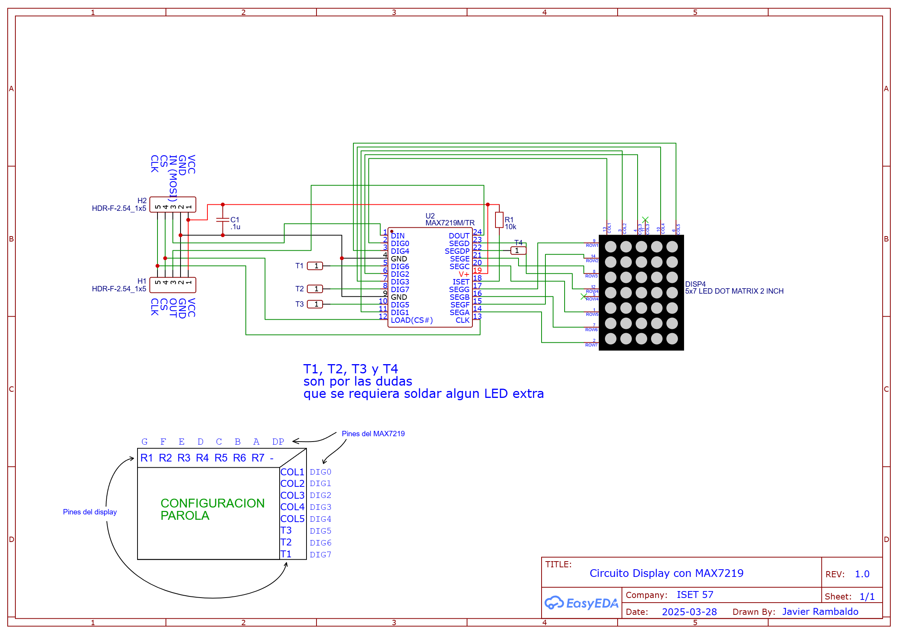

# Tetris con Max7219

## Circuito

## Matriz de displays

    Cada display MAX7219:
    ┌───────────────────┐
    │   7 6 5 4 3 2 1 0 │  ← Columnas 7 a 1 (0 no conectada)
    │ 0 ● ● ● ● ● ● ● x │  ← Fila 0
    │ 1 ● ● ● ● ● ● ● x │  ← Fila 1
    │ 2 ● ● ● ● ● ● ● x │  ← Fila 2
    │ 3 ● ● ● ● ● ● ● x │  ← Fila 3
    │ 4 ● ● ● ● ● ● ● x │  ← Fila 4
    └───────────────────┘
    
  Disposición física de cada display:
  y=24 ->┌─────────┬─────────┐
         │ DISP 4  │ DISP 9  │
         ├─────────┼─────────┤
         │ DISP 3  │ DISP 8  │
         ├─────────┼─────────┤
         │ DISP 2  │ DISP 7  │
         ├─────────┼─────────┤
         │ DISP 1  │ DISP 6  │
         ├─────────┼─────────┤
         │ DISP 0  │ DISP 5  │
  y=0 -->└─────────┴─────────┘
          x=0................x=13
    
## Conexión en cascada:

    ESP32 → DISP0 → DISP1 → DISP2 → DISP3 → DISP4 → DISP5 → DISP6 → DISP7 → DISP8 → DISP9

    DIN del ESP32 (GPIO23) → DIN del DISP0
    DOUT del DISP0 → DIN del DISP1
    DOUT del DISP1 → DIN del DISP2
    ... y así sucesivamente

    CLK y CS van a TODOS en paralelo

    